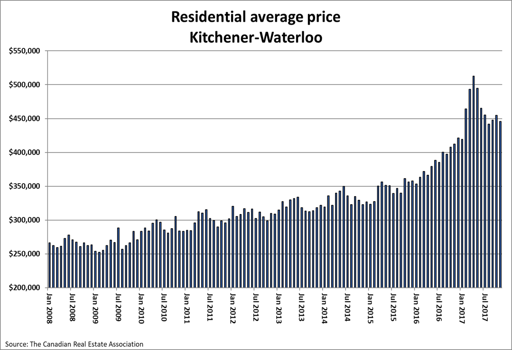

The Kitchener-Waterloo housing market has gotten incredibly hot over the past few years, with the price of homes soaring to all-new highs. Whether you are looking to cash out on your existing home, or buy into a fixer-upper, refinishing hardwood floors can add timeless beauty and loads of value to your home.

Installing new hardwood flooring in your home can be quite costly. However, if you've already got it, why not flaunt it? 

## The Lucky Ones
Check under your carpet. Many homeowners have no idea that they already have beautiful hardwood floors. Most of the brick houses built in the Waterloo Region before the 1950's had hardwood floors installed. In the 70's and 80's, it because popular to cover up those floors with carpet. We often help homeowners remove carpet to reveal hardwood. Lucky for them, refinishing an existing hardwood floor is much cheaper than installing a new one.

## The Fixer Upper Floors
Our bread and butter is floors that are already exposed, but need some love. Years of use on hardwood floors wears through the top layer of finish. To determine if these floors are a good candidate for refinishing, we have to check the remaining depth of the floorboards. This can easily be done by lifting out a floor vent and looking at the cross-section of the floorboards. If there is enough wood left on top of the tongue and groove, then we can safely refinish your floors.

## The Engineered Floors
How many times an engineered floor can be sanded depends on the thickness of its top layer of real wood, called the wear layer. A thick wear layer (3-4 mm or more) can often be sanded two or three times, a 2-3 mm layer usually once, and a thin one not at all, though a buff & coat can still freshen it up. Working with engineered flooring takes extra care, because if the wear layer is too thin, the sanding machines can wear right through it. [Here's how to check what you have](/refinish-or-replace-hardwood-floors).

## Still not sure?
If all else fails and you can't figure out whether or not you have hardwood floors, give us a call.